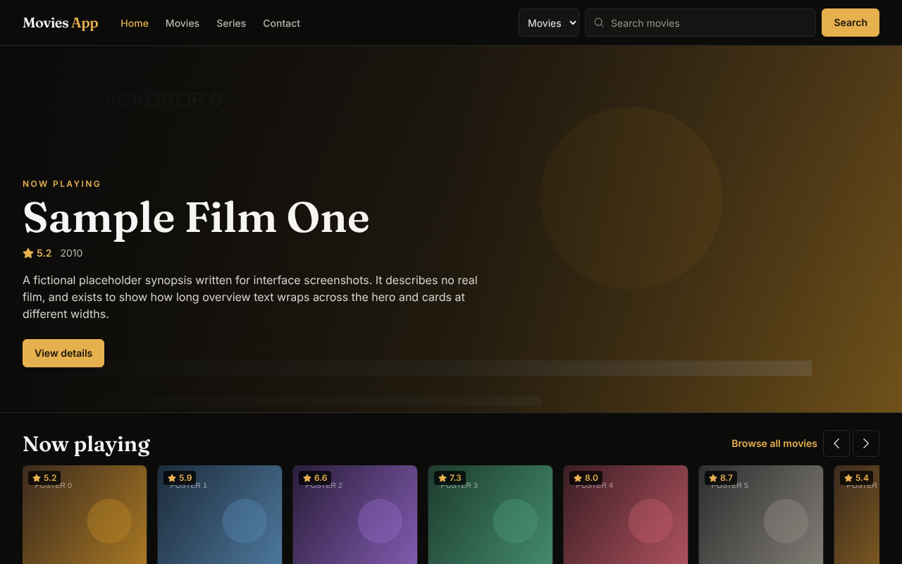
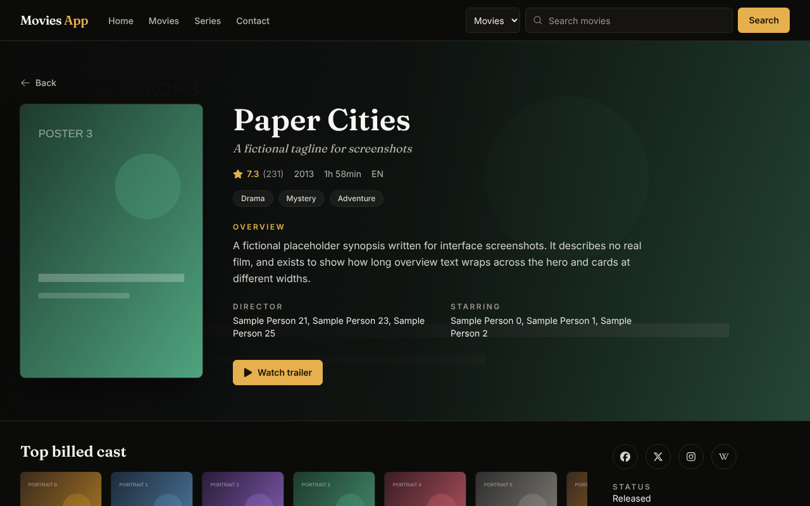
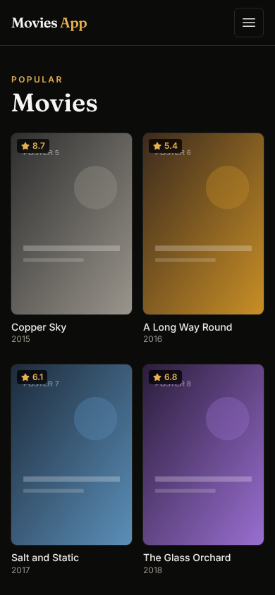

# Movies App

A React single-page app for browsing movies and TV series with data from [TMDB](https://www.themoviedb.org/). It has popular and now-playing lists, search with suggestions, detail pages with a hero, cast, reviews, media and recommendations, person pages, season and episode pages, and a contact form.

Live demo: https://movie-app-one-wine-86.vercel.app

| Home | Movie detail | Movies (mobile) |
| --- | --- | --- |
|  |  |  |

The screenshots were taken against hand-made mock API responses with generated placeholder artwork (titles such as "Sample Film One"), because the TMDB API is not reachable from the environment they were captured in. They show the layout, not real catalogue data.

## Stack

- React 18, Vite 6
- Tailwind CSS 3 (custom tokens in `tailwind.config.cjs`), self-hosted Inter and Fraunces via `@fontsource-variable`
- Redux Toolkit for API state, React Router 7
- `@emailjs/browser` for the contact form, `react-toastify` for toasts, `react-icons`
- ESLint 9, GitHub Actions (lint and build)

## Run it

```bash
npm install
cp .env.example .env   # then fill in the values
npm run dev
npm run build          # production build into dist/
npm run lint
```

### Environment variables (names only)

| Name | Used for |
| --- | --- |
| `VITE_TMDB_TOKEN` | TMDB "API Read Access Token" (v4 bearer token). Required for any data to load. |
| `VITE_EMAILJS_SERVICE_ID` | EmailJS service for the contact form |
| `VITE_EMAILJS_TEMPLATE_ID` | EmailJS template for the contact form |
| `VITE_EMAILJS_PUBLIC_KEY` | EmailJS public key |

Without the TMDB token the home page says so and lists show an error state with a retry button. Without the EmailJS values the contact form is disabled and says why. On Vercel, set these in the project's environment variables and redeploy.

## What changed in this pass

- Removed the TMDB bearer token that was hard-coded in eight source files and moved it to `VITE_TMDB_TOKEN`. EmailJS ids moved to env vars too.
- Requests are encoded properly (search queries), errors reset when a request restarts, and failed lists show a retry state.
- Fixed broken or wrong behaviour: "Show more" links on series media went to `/series/[object Object]/...`, "Latest season" showed the first season, crew never rendered on the movie page (wrong field), person "known for" always linked to `/series/`, the series person page called `alert()` during render, the collection page dispatched nothing, the instagram link on the movie page was malformed, and the home page never showed loading or error states.
- Removed unused dependencies (`npm`, `emailjs-com`, `json-server`, `lucide-react`, `react-show-more-text`, `react-simple-star-rating`, `react-stars`, `sweetalert2`, `framer-motion`, `react-slick`, `slick-carousel`, `@heroicons/react`, `@material-tailwind/react`) and dead components. The production JS bundle went from about 1.29 MB to about 376 KB.
- Removed buttons that did nothing (the "add to wishlist" and "rate movie" icons, and the non-functional sort buttons on the home page).
- Redesigned the UI: dark cinematic theme with a single brass accent, fixed 2:3 poster grid with image fallbacks, skeleton loaders, a shared detail hero for movies and series, a scroll-snap rail on the home page, a keyboard-accessible search combobox, skip link, visible focus rings, native `<dialog>` trailer modal, and `prefers-reduced-motion` support.
- Added a CI workflow that runs `npm run lint` and `npm run build`.

## How it was verified

- `npm run lint` and `npm run build` pass locally.
- Pages were loaded in headless Chromium at 1280x800 and 390x844 with the TMDB API and image requests intercepted by hand-made mock responses (kept outside the repo). Home, movies, series, movie detail, series detail, cast and crew, person (both flows), season, all seasons, all videos, backdrops and posters, reviews pages, collection, search, contact and 404 rendered with no console errors. Error (HTTP 500) and slow-response (skeleton) states were also checked, as were search suggestions with keyboard navigation and opening and closing the trailer dialog.
- Not verified against the live TMDB API or EmailJS, since neither is reachable from the build environment.

## Known limitations

- `VITE_*` variables are bundled into the client, so the TMDB token is visible to anyone who opens the site. Use a read-only token you can rotate, or put a small proxy in front of TMDB.
- The movie and series list pages follow TMDB's cap of 500 pages.
- Data is requested directly from TMDB without caching beyond what Redux holds in memory.
- There are no automated tests; CI covers lint and build only.

## Notes

UI and code quality improvements were made with AI assistance (Claude, Anthropic), reviewed and verified by building and running the app.
